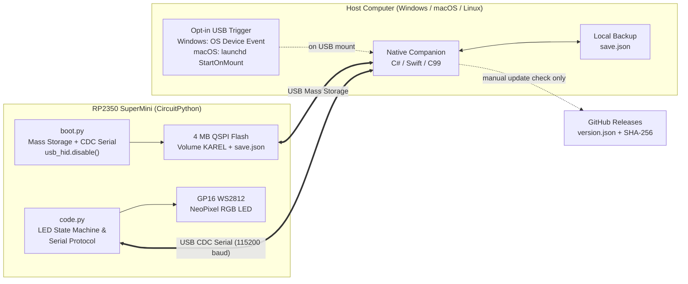

# Karel de Koala

[](https://github.com/EgonRuiter/karel-de-koala/releases/latest)
[](https://github.com/EgonRuiter/karel-de-koala/actions/workflows/release.yml)
[](#getting-started)
[](#hardware)

A portable, zero-install desktop companion powered by an RP2350 USB microcontroller, built for members of [SV Sticky](https://svsticky.nl) (Computer & Information Science study association at Utrecht University).

Plug the USB stick into any Windows, macOS, or Linux machine, launch the companion app directly from the drive, and Karel climbs onto your screen—keeping your progress on the stick and syncing his mood to the onboard RGB LED in real time.

---

## Contents

- [Features](#features)
- [Getting Started](#getting-started)
- [Usage](#usage)
- [Security & Privacy](#security--privacy)
- [Architecture](#architecture)
- [Hardware](#hardware)
- [3D-Printable Enclosure](#3d-printable-enclosure)
- [Building from Source](#building-from-source)
- [Repository Layout](#repository-layout)
- [Troubleshooting](#troubleshooting)

---

## Features

- **Portable & Zero-Install** — Runs directly from the USB drive on Windows, macOS (Universal Apple Silicon + Intel), and Linux with no external runtimes or package managers required.
- **Native Desktop Companions** — Lightweight native binaries for each OS: C# (.NET Framework) on Windows, Swift/AppKit on macOS, and C99/X11 on Linux.
- **64 Animations & Customization** — 234 hand-crafted pixel-art frames shared across platforms, 14 coat colors, and 16 wearable outfits.
- **Hardware RGB LED Sync** — Bidirectional USB serial communication mirrors Karel's state (happy, hungry, studying, party, sleeping) on the RP2350's WS2812 NeoPixel LED.
- **On-Stick Persistence** — XP, level, stats, outfit, and preferences are stored directly on the USB drive (`save.json`) so your companion follows you across computers.
- **Optional Auto-Launch & Clean Removal** — Opt in to launch Karel automatically when the USB stick is plugged in, with idle zero-CPU waiting on Windows, zero background processes on macOS (`launchd`), and one-click uninstallation.
- **Custom 3D-Printable Case** — Snap-fit enclosure sized for the RP2350 SuperMini featuring the SV Sticky mascot logo, integrated LED diffuser, and keychain loop.

---

## Getting Started

### 1. Plug in the USB stick

Connect the RP2350 stick to your computer and open the **`KAREL`** drive. You will see four items:

| File | Platform | How to launch |
|---|---|---|
| `Karel (Windows).exe` | Windows 10 / 11 | Double-click to start. |
| `Karel (Mac).app` | macOS 12+ (Apple Silicon & Intel) | Double-click in Finder. On first launch, right-click → **Open** to approve the unsigned open-source app. |
| `Karel (Linux).sh` | Linux (X11 / XWayland) | Run `bash "Karel (Linux).sh"` in a terminal. |
| `README.md` | All platforms | This documentation. |

All firmware files, sprites, and save data live as hidden files on the drive to keep the root directory uncluttered.

### 2. Optional auto-launch on plug-in

Auto-launch is **disabled by default**. On first launch on Windows or macOS, Karel asks once whether you want him to start automatically whenever the USB stick is connected. You can toggle this at any time from the Hub or context menu.

When you unplug the USB stick, Karel waves goodbye and leaves your screen:

- **Auto-launch off:** The application exits completely.
- **Auto-launch on (Windows):** The window and tray icon close; an idle OS device-event listener waits at 0% CPU until the drive is reconnected.
- **Auto-launch on (macOS):** The application exits completely (0 background processes). A standard user `LaunchAgent` (`StartOnMount`) launches Karel only when the volume mounts.

### 3. Uninstalling

If you enabled auto-launch and want to remove every local file from your computer, click **Uninstall / Verwijder van laptop** in the Hub or right-click menu, or disable auto-launch.

Manual removal commands:

- **Windows:** Delete the registry value `HKCU\Software\Microsoft\Windows\CurrentVersion\Run\KarelDeKoala`, the folder `%LOCALAPPDATA%\KarelDeKoala`, and `%APPDATA%\KarelDeKoala_save.json`.
- **macOS:**
  ```bash
  pkill -x Karel 2>/dev/null
  launchctl unload -w ~/Library/LaunchAgents/nl.svsticky.karel.plist 2>/dev/null
  rm -rf ~/Library/LaunchAgents/nl.svsticky.karel.plist \
         "$HOME/Library/Application Support/KarelDeKoala" \
         "${TMPDIR%/}/Karel_live.app" "${TMPDIR%/}"/karel_mac_upd_*
  ```
- **Linux:**
  ```bash
  rm -rf ~/.local/share/karel-de-koala "${XDG_RUNTIME_DIR:-/tmp}/karel_de_koala_$(id -u)"
  ```

---

## Usage

### Controls

| Input | Action |
|---|---|
| **Click Karel** | Open the Hub (XP/level, stats, coat & outfits, 25-minute Focus timer, settings, updates, uninstall). |
| **Double-click Karel** | Pet Karel (`+8 XP`, heart particles, and LED pulse). |
| **Drag & toss** | Launch Karel across the screen with physics and bounce. |
| **Right-click / tray / menu bar** | Quick menu for actions, 28 tricks, roam modes, scale (`2×–5×`), sound, Auto-Quiet, language (`NL`/`EN`), and quit. |
| **`Ctrl + Alt + K`** *(Windows)* | Hide or summon Karel on demand. |

### Roam Modes

- **Free (`free`):** Walks and hops across the entire desktop.
- **Active Window (`window`):** Sits on top of your active window and parachutes down with an umbrella if the window closes or moves.
- **Follow Cursor (`cursor`):** Chases your mouse pointer.
- **Park (`park`):** Stays in one spot.
- **Auto-Quiet Fullscreen:** Automatically moves Karel aside and mutes sound during fullscreen presentations, videos, or meetings.

### Customization & Extras

- **Coats (14):** `classic`, `sticky`, `mint`, `midnight`, `gold`, `crimson`, `sakura`, `ocean`, `sunset`, `espresso`, `cyber`, `forest`, `snow`, `obsidian`
- **Outfits (16):** `scarf`, `stickycap`, `hoodie`, `headphones`, `shades`, `crown`, `wizard`, `partyhat`, `beanie`, `tophat`, `chef`, `halo`, `bowtie`, `cape`, `labcoat`, `nerd`
- **Focus Timer:** 25-minute Pomodoro session that switches the hardware LED to a calm study glow and awards `+45 XP` on completion.
- **Easter Eggs:**
  - Feed 3 coffees within 2 minutes for *Hyper Mode*.
  - Click Karel's nose 7 times in a row for a surprise sneeze.
  - Enter the Konami code (`↑ ↑ ↓ ↓ ← → ← → B A`) for *Disco Mode*.
  - Time-aware touches: sleepy eyes between `00:00–04:00` and a Friday afternoon drink after `16:00`.

---

## Security & Privacy

Karel is designed to be safe and inspectable on personal and university machines:

- **No USB HID emulation:** [`firmware/boot.py`](firmware/boot.py) explicitly disables USB HID (`usb_hid.disable()`). The board enumerates strictly as USB Mass Storage (`KAREL`) and USB CDC Serial (for LED telemetry). It never acts as a keyboard or mouse and executes nothing on plug-in.
- **Zero background network traffic:** Karel makes no automatic network connections, sends no telemetry, and never downloads files on its own. Network access occurs only when you manually click **Check for updates**, which queries GitHub Releases (`version.json`) and verifies every downloaded artifact against its **SHA-256** checksum before applying it.
- **Open & reproducible builds:** All binaries distributed on the USB drive and GitHub Releases are compiled from this repository via [GitHub Actions](.github/workflows/release.yml).

---

## Architecture



---

## Hardware

### RP2350 SuperMini Pinout

The firmware runs on **CircuitPython 9.2+ / 10.x** on an **RP2350 SuperMini** (`4 MB` QSPI flash; full multi-OS payload uses `~0.93 MB`, leaving `> 2 MB` free).

| Function | Pin | Notes |
|---|---|---|
| **RGB LED (WS2812 NeoPixel)** | `GP16` *(fallback: `GP23`, `GP22`)* | Displays live mood animations; falls back to onboard mono LED (`LED`/`GP17`/`GP25`). |
| **Bootloader** | Onboard `BOOT` | Hold while plugging in to mount the RP2350 UF2 bootloader. |
| **Dev / Safe Mode** | `GP0 → GND` *(or `GP24 → GND`)* | Bridge while plugging in to enable CircuitPython autoreload (cyan LED). |
| **Optional inputs** | `GP1`, `GP2`, `GP3`, `GP15`, `GP24` | External action button, capacitive touch pad (`1 MΩ` pull-up), and toggle button. |

### USB CDC Serial Protocol

Plain UTF-8, newline-delimited messages at `115200` baud:

| Direction | Message | Description |
|---|---|---|
| Host → Board | `KAREL_PING` | Heartbeat and port discovery (1 Hz). |
| Board → Host | `KAREL_PONG` | Handshake response identifying a Karel device. |
| Host → Board | `STATE:HAPPY \| HUNGRY \| HYPER \| SLEEP \| STUDY \| QUIET \| PARTY \| BYE` | Updates the active LED color and animation pattern. |
| Host → Board | `EVENT:HEART \| EVENT:COOLDOWN` | Triggers a brief LED pulse. |
| Board → Host | `EVENT:PET \| FEED \| COFFEE \| MINIGAME \| DISCO \| GIFT \| RST_BOOP \| TOGGLE_KAREL` | Hardware input events from optional buttons or touch pads. |

---

## 3D-Printable Enclosure

Manifold, print-ready STL files for a bare **RP2350 SuperMini** (`18.0 × 23.3–23.5 mm`, without pin headers) are provided in [`case/stl/`](case/stl/):

| File | Dimensions | Description |
|---|---|---|
| [`karel_rp2350_complete_plate.stl`](case/stl/karel_rp2350_complete_plate.stl) | `51.0 × 36.0 × 7.6 mm` | Complete print plate (bottom + lid). |
| [`karel_rp2350_bottom.stl`](case/stl/karel_rp2350_bottom.stl) | `23.0 × 35.6 × 7.6 mm` | Base shell with PCB retention ribs, USB-C cutout (`12.2 × 5.3 mm`), and keychain eye (`Ø 4.6 mm`). |
| [`karel_rp2350_top.stl`](case/stl/karel_rp2350_top.stl) | `23.0 × 28.0 × 5.1 mm` | Snap-fit lid with recessed SV Sticky logo and thin internal diffuser window over `GP16`. |

**Recommended print settings:** `0.4 mm` nozzle, `0.16 mm` layer height, no supports required. White or light-colored PLA/PETG works best for LED diffusion.

To regenerate or customize the STLs (e.g. open LED or BOOT cutout):

```bash
python case/generate_karel_case.py --help
```

---

## Building from Source

### Prerequisites

- **Windows:** Python 3 and .NET Framework 4.x (`csc.exe`, included with Windows).
- **macOS:** Xcode Command Line Tools (`swiftc`, `lipo`, `codesign`).
- **Linux:** `gcc`, `libx11-dev`, and `libxext-dev`.

### Build & Self-Test

Each companion includes a built-in `--self-test` flag verifying sprite rendering, audio synthesis, save parsing, and version/SHA-256 logic:

```bash
# Windows
python desktop/build_native.py
desktop/karel_native.exe --self-test

# macOS (builds Universal arm64 + x86_64 bundle)
bash desktop/build_mac.sh
desktop/Karel.app/Contents/MacOS/Karel --self-test

# Linux (x86_64)
bash desktop/build_linux.sh
KAREL_DRIVE_DIR=desktop desktop/karel_linux_x86_64 --self-test
```

### Provisioning a USB Drive or RP2350

Use [`desktop/prepare_test_usb.py`](desktop/prepare_test_usb.py) to populate a mounted RP2350 (including `boot.py` and `code.py`) or standard USB drive:

```bash
# Preserve existing save.json
python desktop/prepare_test_usb.py --drive D:\

# Fresh install for a new user (resets save.json to level 1)
python desktop/prepare_test_usb.py --drive D:\ --reset-save
```

For batch flashing 50+ boards, see [`DEPLOYMENT_50_BOARDS.md`](DEPLOYMENT_50_BOARDS.md).

### Release Pipeline

Pushing to `main` triggers [`.github/workflows/release.yml`](.github/workflows/release.yml), which builds and self-tests all three platforms, verifies version parity across sources, computes SHA-256 checksums, generates `version.json`, and publishes a GitHub Release.

---

## Repository Layout

```text
karel-de-koala/
├── README.md
├── DEPLOYMENT_50_BOARDS.md          # Batch provisioning guide for 50+ boards
├── .github/workflows/release.yml    # Cross-platform CI/CD & release workflow
├── firmware/
│   ├── boot.py                      # USB configuration (Mass Storage + CDC, HID disabled)
│   └── code.py                      # CircuitPython LED controller & serial protocol
├── desktop/
│   ├── karel_native.cs              # Windows companion (C# / WinForms)
│   ├── karel_mac.swift              # macOS companion (Swift / AppKit)
│   ├── karel_linux.c                # Linux companion (C99 / X11 + XShape)
│   ├── karel_sprites.gz             # Shared compressed sprite archive (64 states, 234 frames)
│   ├── build_native.py              # Windows build script & sprite exporter
│   ├── build_mac.sh                 # macOS Universal app bundle build script
│   ├── build_linux.sh               # Linux build script
│   ├── launch_karel.sh              # Linux USB launcher wrapper
│   ├── prepare_test_usb.py          # USB / RP2350 provisioning tool
│   └── generate_initial_save.py     # Initial save.json & drive icon generator
├── python_extended/                 # Extended Python desktop edition & sprite definitions
└── case/
    ├── generate_karel_case.py       # Parametric STL enclosure generator
    ├── assets/                      # SV Sticky logo assets (.png / .svg)
    └── stl/                         # Print-ready STL files
```

---

## Troubleshooting

- **macOS Gatekeeper warning ("cannot be opened because the developer cannot be verified"):**
  Because this open-source app is not notarized with a paid Apple Developer certificate, macOS blocks the first double-click. Right-click `Karel (Mac).app` → **Open** → **Open**. macOS remembers your choice for subsequent launches.
- **Linux fails with a missing `DISPLAY` error:**
  The Linux companion uses X11/XWayland (`libX11`, `libXext`). Ensure an X11 or XWayland session is active (`echo $DISPLAY`).
- **RGB LED does not react to desktop actions:**
  Make sure no other program (such as a serial monitor or Mu Editor) has the board's data serial port open, and reconnect the USB stick.
- **Updating Karel:**
  Open the Hub or right-click menu and click **Check for updates**. Both the desktop app and `code.py` firmware (when connected) are verified via SHA-256 and updated automatically.
