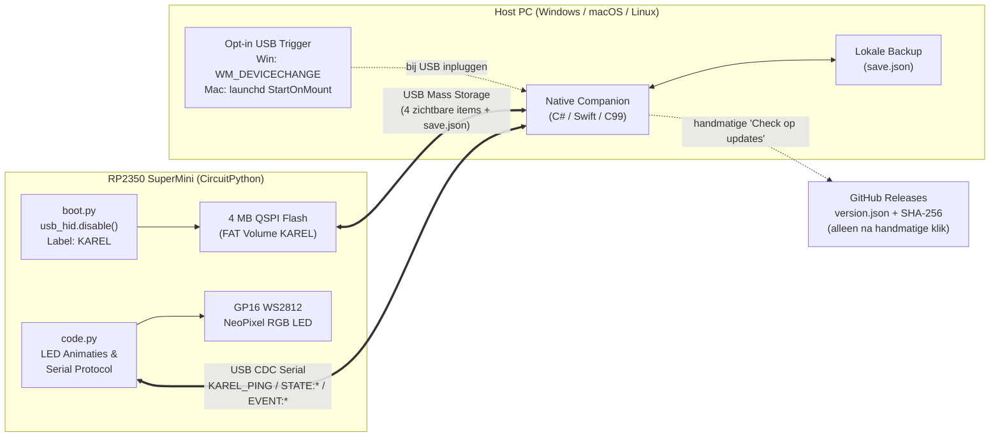

# 🐨 Karel de Koala — SV Sticky Desktop Companion (RP2350)

[](https://github.com/EgonRuiter/karel-de-koala/releases/latest)
[](https://github.com/EgonRuiter/karel-de-koala/actions/workflows/release.yml)
[](#3-snel-aan-de-slag)
[-3ecf8e)](#6-hardware-pinout--serieel-protocol)
[-0d7385)](#2-beveiliging--privacy)

**Karel de Koala** is een **Zero-Install**, cross-platform USB-bureaukoala ontwikkeld voor leden van **Studievereniging Sticky** (Informatica & Informatiekunde, Universiteit Utrecht). Plug de **RP2350 SuperMini** in een Windows-, macOS- of Linux-laptop, open de juiste launcher vanaf de USB-stick, en Karel klimt je scherm op — met je eigen opgeslagen voortgang (`save.json`) direct op de stick én tweezijdige `GP16` RGB LED-synchronisatie via USB Serial.

---

## Inhoudsopgave

1. [Overzicht & Kenmerken](#1-overzicht--kenmerken)
2. [Beveiliging & Privacy](#2-beveiliging--privacy)
3. [Snel aan de slag](#3-snel-aan-de-slag)
4. [Besturing, Outfits, Animaties & Easter Eggs](#4-besturing-outfits-animaties--easter-eggs)
5. [Systeemarchitectuur](#5-systeemarchitectuur)
6. [Hardware, Pinout & Serieel Protocol](#6-hardware-pinout--serieel-protocol)
7. [3D-Printbare Behuizing (SV Sticky Kop-logo)](#7-3d-printbare-behuizing-sv-sticky-kop-logo)
8. [Ontwikkelen, Bouwen & Uitrollen](#8-ontwikkelen-bouwen--uitrollen)
9. [Probleemoplossing & FAQ](#9-probleemoplossing--faq)

---

## 1. Overzicht & Kenmerken

| Onderdeel | Details |
|---|---|
| **Zero-Install Native Apps** | Volledig native zonder externe runtimes: C# / .NET 4.x op Windows (`~110 KB`), Swift / AppKit Universal (`arm64` + `x86_64`) op macOS, en C99 / X11 + XShape (`~88 KB`) op Linux. |
| **Opgeruimde USB-stick** | Alle firmware- en interne bestanden staan op `Hidden` — de gebruiker ziet in Verkenner/Finder precies **4 items**. |
| **54 Animaties (`194` frames)** | Gedeeld gzip-spritearchief (`karel_sprites.gz`) met o.a. *CLIMB*, *DIVE_WAVE*, *UMBRELLA*-paraplulanding, *JETPACK*, *BACKFLIP*, *LAPTOP_CODE*, *GUITAR*, *DRUM*, *SLEEP*, *SNEEZE* en *EARS_WIGGLE*. |
| **6 Vachten & 8 Outfits** | Pixel-art vachten (`classic`, `sticky`, `mint`, `midnight`, `gold`, `crimson`) en volledig uitgewerkte accessoires (`scarf`, `stickycap`, `hoodie`, `headphones`, `shades`, `crown`, `wizard`, `partyhat`). |
| **Hardware RGB LED-sync** | Tweezijdige USB CDC Serial koppeling met de WS2812 NeoPixel (`GP16`) op de RP2350 voor live stemmingskleuren en effecten. |
| **Portabele opslag** | Voortgang (`XP`, level, stats, stijl, taal) blijft op de USB-stick in `save.json`, met `WriteThrough` / `fsync` bescherming tegen plotseling loskoppelen. |
| **3D-Printbare Case** | Waterdichte klikbehuizing met het officiële **SV Sticky Kop-logo**, interne lichtdiffuser voor de LED en sleutelhanger-oog. |

---

## 2. Beveiliging & Privacy

Karel is ontworpen met volledige transparantie voor kritische gebruikers en studielaptops:

- **100% Zero-HID (geen BadUSB / geen `Win+R`):** In [`firmware/boot.py`](firmware/boot.py) staat `usb_hid.disable()` expliciet aan. De RP2350 meldt zich bij het besturingssysteem **uitsluitend** als USB-opslag (`KAREL`) en USB Serial (voor de RGB LED). Er wordt nooit een USB-toetsenbord gesimuleerd en er worden nooit automatisch commando's getypt.
- **0 automatische internetverbindingen:** Karel maakt uit zichzelf **geen enkel netwerkverzoek**, verstuurt geen telemetrie en downloadt nooit iets op de achtergrond. Pas wanneer de gebruiker zelf expliciet op **Check op updates** klikt, wordt `releases/latest/download/version.json` op GitHub geraadpleegd en wordt elke download eerst geverifieerd met **SHA-256**.
- **100% opt-in auto-start:** Automatisch openen bij het inpluggen van de USB-stick staat standaard **uit** en wordt alleen geactiveerd als de gebruiker daar zelf voor kiest.
- **1-klik volledig verwijderen:** Via **Verwijder van laptop / Mac** (in de Hub of het rechtsklikmenu) of door auto-start uit te zetten worden alle lokale sporen (opstartvermelding, gekopieerde app, tijdelijke mappen en lokale back-up) direct verwijderd.
- **Corruptiebestendige opslag:** `save.json` wordt altijd zonder UTF-8 BOM weggeschreven met `FileOptions.WriteThrough` + `Flush(true)` (Windows) of `fsync()` (macOS/Linux), zonder `.tmp`-bestanden op de FAT-schijf aan te maken die bij abrupt loskoppelen het bestandssysteem kunnen beschadigen.

---

## 3. Snel aan de slag

### Inhoud van het USB-station `KAREL`
Zodra je de RP2350 inplugt en het station **`KAREL`** opent, zie je slechts **4 bestanden**:

| Bestand | Besturingssysteem | Gebruik |
|---|---|---|
| **`Karel (Windows).exe`** | Windows 10 / 11 | Dubbelklik om direct te starten (PE `0x0400` swap-safe, eigen koala-icoon). |
| **`Karel (Mac).app`** | macOS 12+ (Apple Silicon & Intel) | Dubbelklik in Finder *(bij Gatekeeper-melding: rechtsklik → **Open**)*. |
| **`Karel (Linux).sh`** | Linux (X11 / XWayland) | Start in terminal met `bash "Karel (Linux).sh"` (omzeilt FAT32 `noexec` automatisch). |
| **`Lees mij.html`** | Alle systemen | Zelfstandige NL/EN startpagina die automatisch je OS detecteert en het juiste bestand aanwijst. |

*(Alle interne bestanden zoals `boot.py`, `code.py`, `lib/`, `save.json`, `.karel_linux_x86_64` en `karel_sprites.gz` staan op `Hidden`.)*

### Optioneel automatisch openen bij inpluggen & automatisch sluiten
1. **Eerste start (als auto-start uit staat):** Op Windows en macOS verschijnt eenmalig de korte vraag *"Karel voortaan automatisch starten?"* (`Ja, automatisch` / `Nee, alleen nu` / `README`).
2. **Automatisch loskoppelen:** Trek je de RP2350 uit je laptop, dan zwaait Karel gedag en duikt hij direct weg van je scherm:
   - **Auto-start UIT:** Karel sluit volledig af.
   - **Auto-start AAN op Windows:** Karel duikt weg, verbergt het systeemvak-icoon volledig en slaapt met **0% CPU** via `RegisterDeviceNotification(GUID_DEVINTERFACE_VOLUME)` (`WM_DEVICECHANGE`). Zodra je de stick weer inplugt, klimt hij binnen ~1–2 seconden automatisch weer je scherm op.
   - **Auto-start AAN op macOS:** Karel sluit volledig af (**0 achtergrondprocessen, 0 MB RAM, geen menubalk-icoon**). De standaard `LaunchAgent` (`StartOnMount = true`) start Karel pas opnieuw zodra de `KAREL`-stick wordt aangekoppeld.

### Handmatig verwijderen van je laptop
In de app zelf klik je op **Verwijder van laptop / Mac** in de Hub of het rechtsklikmenu. Handmatig verwijderen kan ook altijd:
- **Windows:** Verwijder registerwaarde `HKCU\Software\Microsoft\Windows\CurrentVersion\Run\KarelDeKoala`, map `%LOCALAPPDATA%\KarelDeKoala` en bestand `%APPDATA%\KarelDeKoala_save.json`.
- **macOS (Terminal):**
  ```bash
  pkill -x Karel 2>/dev/null
  launchctl unload -w ~/Library/LaunchAgents/nl.svsticky.karel.plist 2>/dev/null
  rm -rf ~/Library/LaunchAgents/nl.svsticky.karel.plist \
         "$HOME/Library/Application Support/KarelDeKoala" \
         "${TMPDIR%/}/Karel_live.app" "${TMPDIR%/}"/karel_mac_upd_*
  ```
- **Linux:** `rm -rf ~/.local/share/karel-de-koala "${XDG_RUNTIME_DIR:-/tmp}/karel_de_koala_$(id -u)"`

---

## 4. Besturing, Outfits, Animaties & Easter Eggs

### Besturing & Interacties
| Actie | Resultaat |
|---|---|
| **Klik op Karel** | Open de **Sticky Hub** (XP/level, honger/blijdschap/energie/hygiëne, stijl, Focus-timer, auto-start, updates & uninstall). |
| **Dubbelklik op Karel** | Aai Karel (`+8 XP`, hartjesdeeltjes en RGB LED-puls). |
| **Sleep & gooi Karel** | Jetpack-vlucht over je scherm met zwaartekracht en randstuiter. |
| **Rechtsklik (of tray / menubalk)** | Snelmenu voor acties, 18 trucjes, 4 loopmodi, schaal (`2×–5×`), geluid, Auto-Stil, taal (`NL`/`EN`), updates & afsluiten. |
| **`Ctrl + Alt + K` (Windows)** | Verberg Karel achter de taakbalk of roep hem direct terug. |

### Zwerfmodi (*Roam Modes*)
- **Heel Scherm (`free`):** Wandelt en springt vrij over je bureaublad.
- **Op Actief Venster (`window`):** Klimt bovenop het actieve venster en opent zijn **Sticky-paraplu (`UMBRELLA`)** zodra dat venster verdwijnt.
- **Volg Muis (`cursor`):** Rent achter je muiscursor aan.
- **Blijf Zitten (`park`):** Blijft rustig op één plek zitten.
- **Auto-Stil Fullscreen:** Verplaatst Karel automatisch naar de hoek en dempt geluid tijdens presentaties, video's of vergaderingen (Teams, Zoom, Google Meet, PowerPoint).

### Vachten, Outfits & Easter Eggs
- **6 Vachten:** `classic` (koalagrijs), `sticky` (Sticky-rood), `mint`, `midnight` (paars/blauw), `gold`, `crimson`.
- **8 Outfits** *(strikt 1 item tegelijk, slim gemaskeerd tijdens speciale animaties)*: `scarf`, `stickycap`, `hoodie`, `headphones`, `shades`, `crown`, `wizard`, `partyhat`.
- **Focus-modus (25 min):** Pomodoro-timer die de LED op rustig studielicht zet en `+45 XP` geeft na voltooiing.
- **Easter Eggs:**
  - **Cafeïne Overdosis:** Geef 3× koffie binnen 2 minuten → *200 MHz Hyper Mode*!
  - **BBG Stof:** Klik 7× achter elkaar op Karels neus → *Hatsjoe!*
  - **Konami-code (`↑ ↑ ↓ ↓ ← → ← → B A`):** Start *Disco Borrel Mode* met zonnebril en regenboog-LED!
  - **Tijdgevoelige details:** Slaperige ogen tussen `00:00–04:00` en een VrijMiBo-drankje op vrijdag na `16:00`.

---

## 5. Systeemarchitectuur



---

## 6. Hardware, Pinout & Serieel Protocol

### RP2350 SuperMini Pinout
De firmware ([`firmware/boot.py`](firmware/boot.py) & [`firmware/code.py`](firmware/code.py)) draait onder **CircuitPython 9.2+ / 10.x** op de **RP2350 SuperMini** (`4 MB` QSPI Flash; totale payload inclusief alle 3 OS-apps is **`~0,93 MB`**, dus **`> 2,0 MB` vrij**).

| Functie | Pin | Beschrijving |
|---|---|---|
| **WS2812 RGB LED (NeoPixel)** | `GP16` *(fallback: `GP23`/`GP22`)* | Spiegelt Karels stemming live via USB Serial; met fallback naar onboard mono LED (`LED`/`GP17`/`GP25`). |
| **`BOOT`-knop** | Onboard `BOOT` | Houd ingedrukt tijdens inpluggen voor RP2350 UF2-bootloader (`RP2350` drive). |
| **Dev / Safe Mode** | `GP0 → GND` *(of `GP24 → GND`)* | Houd verbonden tijdens inpluggen voor Dev-modus (cyaan LED + CircuitPython autoreload aan). |
| **Optionele hardware** | `GP1` / `GP2` / `GP3` / `GP15` / `GP24` | Ondersteuning voor externe actieknop, capacitieve aai-pad (`1 MΩ` pull-up op RP2350) en toggle-knop. |

### USB CDC Serieel Protocol (`115200` baud, newline-gescheiden UTF-8)
| Richting | Bericht | Betekenis |
|---|---|---|
| Host → RP2350 | `KAREL_PING` | Heartbeat / poortdetectie (1× per seconde). |
| RP2350 → Host | `KAREL_PONG` | Bevestiging van actieve Karel-stick. |
| Host → RP2350 | `STATE:HAPPY \| HUNGRY \| HYPER \| SLEEP \| STUDY \| QUIET \| PARTY \| BYE` | Stelt de live RGB LED-animatie en kleur in. |
| Host → RP2350 | `EVENT:HEART \| EVENT:COOLDOWN` | Korte roze hartjes- of bevestigingspuls op de LED. |
| RP2350 → Host | `EVENT:PET \| FEED \| COFFEE \| MINIGAME \| DISCO \| GIFT \| RST_BOOP \| TOGGLE_KAREL` | Hardware-events van optionele knoppen/touchpads of herstart-boop. |

---

## 7. 3D-Printbare Behuizing (SV Sticky Kop-logo)

In [`case/stl/`](case/stl/) staan waterdichte, printklare STL-bestanden op maat voor een **kale RP2350 SuperMini** (`18,0 × 23,3–23,5 mm` zonder pinheaders), voorzien van het officiële **SV Sticky Kop-logo** uit [`case/assets/hoofd_outline_kleur.png`](case/assets/hoofd_outline_kleur.png) / [`.svg`](case/assets/hoofd_outline_kleur.svg):

| Bestand | Afmetingen | Beschrijving |
|---|---|---|
| [`case/stl/karel_rp2350_complete_plate.stl`](case/stl/karel_rp2350_complete_plate.stl) | `51,0 × 36,0 × 7,6 mm` | Bodem en deksel samen naast elkaar — direct in je slicer laden. |
| [`case/stl/karel_rp2350_bottom.stl`](case/stl/karel_rp2350_bottom.stl) | `23,0 × 35,6 × 7,6 mm` | Onderbak met 6 PCB-klemribbels, `12,2 × 5,3 mm` USB-C uitsparing & `Ø 4,6 mm` sleutelhanger-oog. |
| [`case/stl/karel_rp2350_top.stl`](case/stl/karel_rp2350_top.stl) | `23,0 × 28,0 × 5,1 mm` | Klikdeksel met gecentreerd `-0,6 mm` verzonken **Sticky Kop-logo**, interne `0,42 mm` lichtdiffuser boven `GP16` en afgedekte `BOOT`-knop. |

- **Printadvies:** `0,4 mm` nozzle, `0,16 mm` laagdikte, **geen supports nodig**, bij voorkeur wit/licht PLA of PETG zodat de `GP16` RGB LED mooi door de interne diffuser schijnt.
- **Zelf regenereren:** `python case/generate_karel_case.py` *(opties: `--open-led`, `--open-boot`, `--out-dir`)*.

---

## 8. Ontwikkelen, Bouwen & Uitrollen

### Lokaal bouwen & self-tests
Alle 3 desktop-apps bevatten een ingebouwde `--self-test` (sprite-rendering, audio-synthese, save-parser en SHA-256/versie-check):

```bash
# Windows (.NET Framework 4.x csc.exe + Python 3)
python desktop/build_native.py
"desktop/karel_native.exe" --self-test

# macOS (Xcode Command Line Tools -> Universal arm64 + x86_64 Karel.app)
bash desktop/build_mac.sh
desktop/Karel.app/Contents/MacOS/Karel --self-test

# Linux (gcc + libx11-dev + libxext-dev)
bash desktop/build_linux.sh
KAREL_DRIVE_DIR=desktop desktop/karel_linux_x86_64 --self-test
```

### USB-stick of RP2350 flashen
Met [`desktop/prepare_test_usb.py`](desktop/prepare_test_usb.py) richt je zowel een **RP2350 SuperMini** (inclusief `boot.py`, `code.py` en het opschonen van oude bestanden) als een gewone USB-stick direct in met de schone 4-item indeling, met behoud van een bestaande `save.json`:

```bash
python desktop/prepare_test_usb.py --drive D:\
```

Voor het in serie programmeren van **50+ bordjes** zie [`DEPLOYMENT_50_BOARDS.md`](DEPLOYMENT_50_BOARDS.md).

### Automatische CI/CD Releases
Elke push naar `main` triggert [`.github/workflows/release.yml`](.github/workflows/release.yml):
1. Bouwt & self-test `karel_native.exe` (`windows-latest`), Universal `Karel-macOS-App.zip` (`macos-latest`) en `karel_linux_x86_64` (`ubuntu-latest` met `-Wall -Wextra -Werror`).
2. Verifieert dat versienummers in C#, Swift en C identiek zijn.
3. Berekent alle **SHA-256** checksums, genereert `version.json` en publiceert een GitHub Release.

### Mappenstructuur
```text
karel-de-koala/
├── README.md                        # Projectdocumentatie (dit bestand)
├── DEPLOYMENT_50_BOARDS.md          # Mass-flashing handleiding voor 50+ RP2350 bordjes
├── .github/workflows/release.yml    # Multi-platform CI/CD & SHA-256 Release pipeline
├── firmware/
│   ├── boot.py                      # Zero-HID (usb_hid.disable), label KAREL, Dual CDC
│   └── code.py                      # RP2350 firmware: NeoPixel LED, Serial protocol & sensoren
├── desktop/
│   ├── karel_native.cs              # Windows native C# companion (WM_DEVICECHANGE, WriteThrough)
│   ├── karel_native.exe             # Voorgebouwde Windows binary (met embedded sprites & icoon)
│   ├── karel_mac.swift              # macOS native Swift/AppKit companion (StartOnMount, fsync)
│   ├── build_mac.sh                 # Bouwt Universal Karel.app (arm64 + x86_64)
│   ├── karel_linux.c                # Linux native C99 X11/XShape companion
│   ├── build_linux.sh / launch_karel.sh
│   ├── Lees mij.html                # OS-detecterende start- & transparantiepagina op de stick
│   ├── karel_sprites.gz             # Gedeeld sprite-pakket (54 animaties, 194 frames)
│   ├── build_native.py              # Exporteert sprites + compileert PE 0x0400 Windows binary
│   ├── prepare_test_usb.py          # Richt RP2350 / USB-stick schoon in (4 zichtbare items)
│   └── generate_initial_save.py     # Genereert save.json, .karel_drive & drive-iconen
├── python_extended/                 # Optionele uitgebreide Python-editie (10 minigames, 7 tabs)
└── case/
    ├── generate_karel_case.py       # Parametrische STL-generator met SV Sticky Kop-logo
    ├── assets/                      # Officiële huisstijl Kop-logo bestanden (.png / .svg)
    └── stl/                         # Printklare, waterdichte STL-bestanden
```

---

## 9. Probleemoplossing & FAQ

- **macOS zegt *"Karel (Mac).app kan niet worden geopend omdat de ontwikkelaar niet kan worden geverifieerd"*:**
  Omdat de app open-source is en geen betaald Apple Developer-certificaat gebruikt, geeft macOS Gatekeeper eenmalig deze melding. Klik met **rechts** op `Karel (Mac).app` → **Open** → **Open**. Daarna onthoudt macOS je keuze.
- **Hoe weet ik zeker dat deze USB-stick veilig is?**
  USB HID is uitgeschakeld in [`firmware/boot.py`](firmware/boot.py) (`usb_hid.disable()`), er is geen automatisch netwerkverkeer, en alle binaries op de stick worden reproduceerbaar gebouwd vanuit deze openbare GitHub-repository via [`.github/workflows/release.yml`](.github/workflows/release.yml).
- **Karel startte na het inschakelen van auto-start niet op Windows:**
  Zorg dat je `Karel (Windows).exe` éénmaal hebt gestart en *Automatisch openen bij USB* aan staat. Bij loskoppelen verdwijnt ook het systeemvak-icoon (0% CPU slaapstand); na opnieuw inpluggen klimt Karel binnen enkele seconden vanzelf weer op je scherm.
- **Mijn voortgang (`save.json`) lijkt beschadigd na abrupt uittrekken:**
  Vanaf `v2.2.1` wordt `save.json` direct doorgeschreven (`WriteThrough` / `fsync`) zonder `.tmp`-bestanden op USB. Mocht het toch ooit misgaan, dan herstelt Karel bij de volgende start stil vanuit je lokale back-up.
- **Linux geeft *"Geen X11/XWayland DISPLAY gevonden"*:**
  Karel gebruikt op Linux X11/XWayland (`libX11` + `libXext`). Controleer of XWayland actief is (`echo $DISPLAY`).
